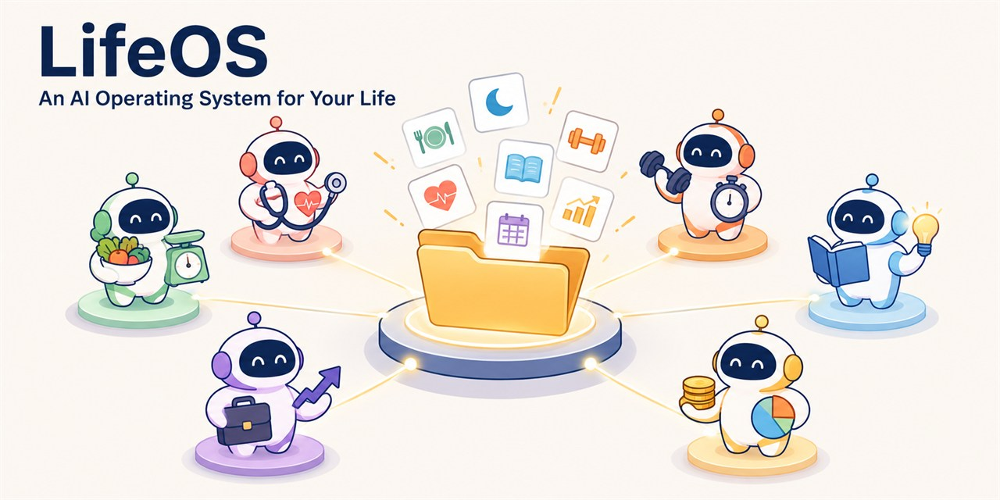
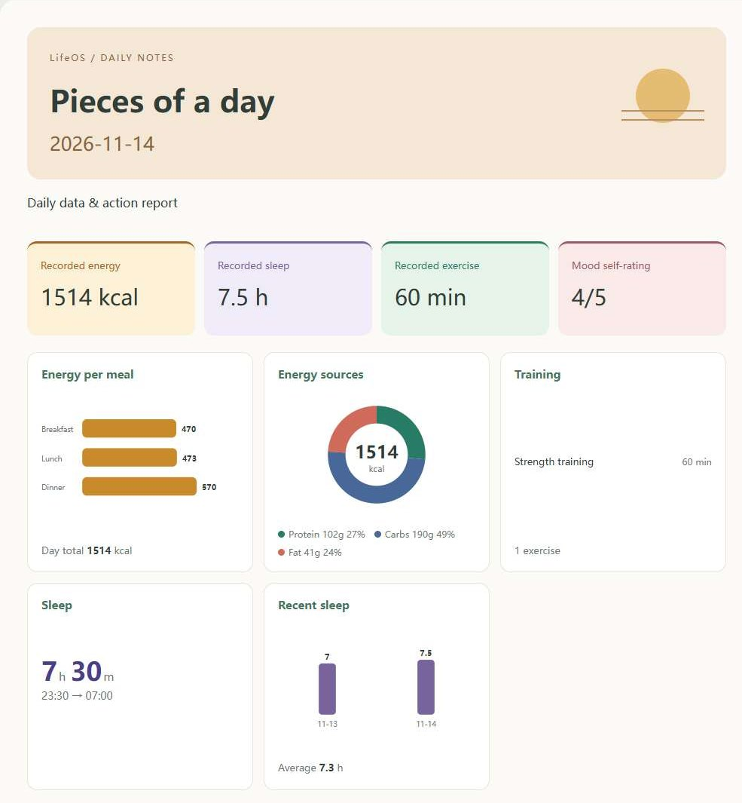

<p align="center"></p>

<h1 align="center">LifeOS</h1>

<p align="center"><b>An AI Operating System for Your Life</b><br>Models change. Your files stay.</p>

<p align="center">
  <a href="LICENSE"></a>
  
</p>

<p align="center">English | <a href="README.zh-CN.md">简体中文</a></p>

**In 30 seconds**

- **What:** a personal assistant whose memory, records and instructions are plain Markdown/JSON files in a folder you own.
- **Who it serves:** anyone who wants one assistant for meals, sleep, training, study, work, money and trips, without locking their life into one app or one model.
- **How:** deploy a vault, open it with Claude Code, Codex CLI, Gemini CLI or Cursor, and talk normally. Switch models any time; the files stay.

LifeOS is a personal assistant made of plain files. Your daily records, profile, long-term memory and advice, together with the instructions the assistant follows, live in one folder of Markdown and JSON that you own. Any AI agent that can read and write files and run Node.js can open that folder and take over: Claude Code, Codex CLI, Gemini CLI, Cursor or anything that reads `AGENTS.md`. Models are replaceable; the files stay the same. There is no server, no account and no database.

> **Repository or vault?** This repository is the LifeOS source. Its own `journal/`, `profile/`, `records/`, `memory/` and other personal folders hold fictional sample data used for development; do not record your life there. You deploy a separate **vault** (see Quick start) and use that. If you are reading this file inside your deployed vault, those folders are yours and started empty; skip to [Starting a session](#starting-a-session).

## Features

- **Daily records.** Meals (text or photos), exercise, sleep, symptoms, weight, mood, study and work go into a dated journal and versioned records. Your words are kept verbatim; estimates carry ranges; unknown stays unknown, never zero.
- **Quick paths.** A simple record or question follows a short guide and one script call instead of the full procedure, so it costs about as much as an ordinary chat.
- **A coach, not just a logger.** After saving, the assistant gives 1-3 specific suggestions (what the next meal could add, a tweak for tomorrow, recovery after training) and asks with numbered options when something unclear would change the result.
- **Expert roles.** Nutritionist, health advisor, fitness coach, study coach (planning, resources, AI teaching), career coach, psych coach (emotions and interpersonal situations), shopping advisor, finance advisor and travel planner. A critic reviews important plans; a panel brings several experts to one problem. The evolver role adds or changes experts.
- **Long-term memory.** Dated, sourced facts and events across years. Requests can be paused, resumed, cancelled or re-planned.
- **Learns how you like things.** A correction such as "assume food is cooked" becomes a short working note that every session reads, in `profile/working.md`. Your own tweaks to a procedure live in `local/` and survive upgrades; changes worth sharing are written up as proposals in `evolve/pending/`.
- **Digests.** A literature digest (all papers of your journals plus preprints, screened against your research interests, scored, and reported with the full original abstract, a complete translation and an assessment) or a news digest from your feeds. The pipeline is shared, so further kinds plug in.
- **Daily report.** A data-and-actions summary of a day as JSON, Markdown and HTML, with an optional PDF.
- **Privacy first.** Every personal detail is voluntary, and a declined topic stays declined for every model that opens the vault.
- **Advice only for money and bookings.** Shopping, travel and finance are research and advice; LifeOS never buys, books, pays or submits forms. For shopping research you may log in yourself in the browser and LifeOS will only read: no cart, checkout, orders, payment or coupon claiming, and credentials are never requested or stored.

## See it in action

One fictional day, sent as plain messages:

> - *"Breakfast: a bowl of oats with a glass of milk, a boiled egg and a banana."*
> - *"Lunch at the canteen: a bowl of rice, chicken breast with broccoli, tomato and egg."*
> - *"Leg day at the gym, squats 5x5, about an hour, pretty tired."*
> - *"Dinner: a piece of salmon, tofu, a small bowl of rice, then a cup of yogurt."*
> - *"Bed at 11:30, up at 7, slept well."*

Each message is saved in one step with portion assumptions and ranges, followed by short suggestions. The next morning's sleep message triggers the daily report:

<p align="center"></p>

The report also comes as Markdown, JSON and PDF. A value that some foods cannot supply (here fiber, missing for several items in the composition table) is shown as a lower bound, never as a shortfall.

## Requirements

- **Node.js 20 or newer.** The tools are dependency-free Node scripts; nothing to install.
- **An AI agent** that can read and write files in a folder and run commands. Reading meal photos and web research depend on the model and tool you use.
- **Optional, for PDF reports:** a PDF runtime installed with npm outside the vault, and an embeddable CJK font.

## Quick start

```bash
git clone https://github.com/zhober/lifeos.git
cd lifeos
node tools/deploy.mjs ~/lifeos-vault           # preview: lists what would be created
node tools/deploy.mjs ~/lifeos-vault --apply   # create the vault
```

A relative target is resolved against your current directory; in Windows PowerShell use a full path such as `$HOME\lifeos-vault`. The vault gets the instructions, tools and empty personal folders (no sample data) and can live anywhere, including a synced folder.

## Starting a session

Open the vault folder as your agent's working directory.

- **Claude Code**, from the vault folder:

  ```bash
  claude --setting-sources user --settings config/runtimes/claude-code.json --append-system-prompt-file config/BOOTSTRAP.md
  ```

  The `--settings` adapter is optional: it adds edit permissions for the data folders and a startup hook that prints the date, timezone and language. `claude --append-system-prompt-file config/BOOTSTRAP.md` also works.
- **Agents that read `AGENTS.md` automatically** (for example Codex CLI): start them in the vault folder.
- **Anything else:** load `config/BOOTSTRAP.md` as an instruction or system prompt, or begin with "Read AGENTS.md and follow it."

The first time, the assistant asks which language you prefer (English until you choose; if you write in another language it asks in that one). Everything else in the profile is optional.

## How to talk to it

Write normally; the assistant routes each message by intent.

| You say | What happens |
|---|---|
| "Lunch: beef noodles, about 250 g, and a braised egg. Ran 30 min, knee a bit sore. Slept 1:00 to 7:30." | Quick record: words archived, meal, exercise, symptom, sleep and journal written in one step; a short confirmation with ranges, then 1-3 suggestions |
| *(a meal photo, or a sleep screenshot)* | Quick path too: the original is kept; a vision-capable model estimates foods and portions with stated assumptions |
| "Actually the buns were pork, and the soy milk was lightly sweet." | Quick correction: the meal gets a new version, the old one is kept and the day is re-summed |
| "How did I sleep last week?" | Quick answer from your records, labelled as data, estimate or missing |
| "Ask the fitness coach how to train legs with a bad knee" | Consultation with one expert; important plans can go through the critic |
| "Panel: I've been tired for weeks, what should I change?" | Several experts, one combined plan, critic review |
| "Review this week" / "Make my daily report for yesterday" | Weekly review / daily report |
| "Teach me linear algebra from vectors" | Study coach in teaching mode; lessons continue later |
| "Pause that" / "Cancel the trip request" / "Change the goal to ..." | The request is paused, cancelled or re-planned; finished results are kept |

Re-dating or retracting a record, importing documents, and finance, shopping, travel or career records use the full procedure automatically. Workflow names (`/log`, `/ask`, `/panel`, `/review`, `/report`, `/learn`, `/import`, `/setup`, `/expert`) work as slash commands only if your tool registers them; plain language always works. `node tools/experts.mjs` lists the experts.

## Where your data lives

| Location | Contents |
|---|---|
| `journal/YYYY/YYYY-MM-DD.md` | One journal per day: numbers in the frontmatter, sections below, and an append-only raw section with your words |
| `records/` | Versioned structured records: meals, nutrition days, training, health, career, shopping, finance, shared cases |
| `inbox/<source>/` | Originals you supply (meal photos, exports, documents), kept unchanged |
| `advice/`, `reviews/`, `reports/daily/` | Recommendations, weekly and monthly reviews, daily reports |
| `memory/`, `tasks/`, `actions/`, `history/` | Long-term memory, requests and their steps, actions and outcomes, snapshots of writes |
| `profile/`, `experts/`, `data/food/custom.json` | Profile, goals, `preferences.json`; per-expert notes; your own foods |

Corrections create new versions instead of rewriting. Any Markdown editor (for example Obsidian) can browse the vault.

## Settings

Run from the vault root, or ask the assistant.

```text
node tools/language.mjs show | set en                  interaction language (zh-CN, ja, de, ...)
node tools/settings.mjs show                           timezone and its source, region, currency, shops
node tools/settings.mjs set timezone Europe/Berlin     any IANA name; "system" follows the machine clock
node tools/settings.mjs set region DE                  ISO 3166-1 alpha-2; "none" clears it
node tools/settings.mjs set currency EUR               ISO 4217; "none" clears it
node tools/settings.mjs set marketplaces amazon,ebay   shops to compare; same for experience_channels
node tools/privacy.mjs show health                     effective privacy choices for a subject
```

No region is built in. The timezone comes from your saved preference, then `project.json`, then the `LIFEOS_TIMEZONE` environment variable, then the system clock. Existing records keep the timezone they were written with. Region, currency and shops are asked only when a task needs them.

## Privacy

Everything personal is voluntary: health, body, family, relationships, work, location and money. You can give ranges, anonymous descriptions or nothing. A declined question is not asked again, rephrased, passed to another expert or reconstructed from old files; a lasting restriction is saved in `profile/preferences.json` and applies to every model. If a page needs a login for shopping or travel research, you log in yourself; credentials are never stored in the vault.

These are instructions the model follows, not encryption: protect the vault like any private files, and remember that your model provider sees what the model reads.

## Daily report

Ask for a report for any date, or simply submit your morning sleep: once it is recorded and its descriptive analysis is done, the report for the previous day is produced, whatever the time. A day with nothing but that sleep is skipped. Missing data stays missing, never zero.

Without a PDF runtime you still get JSON, Markdown and HTML. For PDF, run `node tools/report-setup.mjs <directory-outside-the-vault>` (uses npm and the network), point LifeOS to it with `--runtime` or `LIFEOS_PDF_RUNTIME`, and provide an embeddable CJK font; see `config/runtimes/pdf/README.md`.

## Food data

No food composition table is distributed, for licensing reasons. Without one, everything still works: your own foods in `data/food/custom.json` and package-label values are calculated, and nutrients for anything else stay unknown. To build the China Food Composition Table for personal use from a public conversion, run `node tools/build-food.mjs <source-dir> [gi.json]`; `data/food/README.md` explains this and the JSON format for converting any other table you are entitled to use. Built tables must not be redistributed.

## Upgrading

Update your clone and run the same command against your existing vault:

```bash
git pull
node tools/deploy.mjs ~/lifeos-vault           # preview
node tools/deploy.mjs ~/lifeos-vault --apply
```

Personal data is never overwritten. System files you edited in the vault are kept and reported as skipped (`--force` overwrites them). System files a new version removed are deleted only if you never changed them. Language, timezone and privacy choices survive upgrades.

## Troubleshooting

- **"Write is locked by ..."**: another write is running or was interrupted. Retry. `node tools/files.mjs locks` lists locks; `node tools/files.mjs locks --clear-stale` removes only provably stale ones. Locks live in a machine-local directory outside the vault, so sync tools never copy them.
- **Conflict copies**: if two devices changed the same file in a synced vault, the sync tool may leave a copy. LifeOS reports it and never merges. `node tools/conflicts.mjs` lists each copy and its original; keep the content you want in the original, then delete the copy.
- **Layout check**: `node tools/check-layout.mjs` validates structure and settings; it never changes anything.
- **Wrong date**: check `node tools/settings.mjs show`. A message sent between 00:00 and 03:59 usually counts for the day that just ended; sleep is stored on the waking date.
- **Nutrition shows unknown**: the food is in neither `custom.json` nor an installed table; add it or give label values.

## Known limitations

- Journal headings, table columns and many tool messages are in Chinese. The journal format is a fixed storage schema; the assistant talks to you in your chosen language.
- Quality of estimates, advice and review depends on the model. Scripts handle storage, arithmetic and checks; judgment is the model's.
- No background scheduler: nothing runs unless you talk to your agent.
- Memory search is local keywords, aliases and explicit links; no embeddings.
- PDF reports need the optional runtime and a CJK font.

## Disclaimer

LifeOS is not a medical, financial or legal service. It does not diagnose or prescribe, and its output is not a substitute for a qualified professional. In an emergency, or if you are at risk of harming yourself, contact local emergency services right away.

## More

`docs/core/HANDBOOK.md` (full reference), `config/CONFIGURATION.md` (configuration and runtimes), `docs/domains/` (per-domain rules), `evolve/changelog.md` (changes).

## License

MIT. See [LICENSE](LICENSE).
